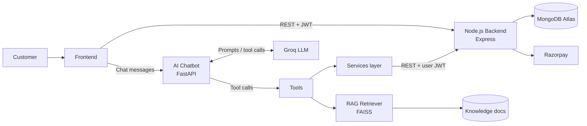

# 🛒 E-commerce Customer Care Chatbot

An AI-powered customer care chatbot for an online store. Customers can chat in natural language to find products, manage their cart, check out, track orders, raise support tickets, and get answers to policy and FAQ questions.

The project combines a **Node.js e-commerce backend** with a **Python AI service** that uses an LLM with tool calling and RAG (retrieval-augmented generation).

---

## 📑 Table of Contents

- [Features](#-features)
- [Tech Stack](#️-tech-stack)
- [Architecture](#-architecture)
- [Project Structure](#-project-structure)
- [Prerequisites](#-prerequisites)
- [Getting Started](#-getting-started)
  - [1. Backend (Node.js)](#1-backend-nodejs)
  - [2. AI Chatbot (Python)](#2-ai-chatbot-python)
  - [3. Frontend](#3-frontend)
- [Environment Variables](#-environment-variables)
- [API Reference](#-api-reference)
- [Chatbot Capabilities](#-chatbot-capabilities)
- [Roadmap](#-roadmap)
- [Contributing](#-contributing)
- [Author](#-author)

---

## ✨ Features

**E-commerce backend**
- Product catalog with category filtering and CSV-based seeding
- JWT authentication (register, login, current user)
- Shopping cart and checkout with Razorpay payments (test mode supported)
- Order history, cancellation, and return requests
- Centralized error handling

**AI chatbot**
- Natural-language conversations powered by an LLM (Groq)
- Tool calling: product search, cart, checkout, orders, and support tickets
- RAG over a knowledge base (FAQs, shipping, return, and refund policies) using FAISS and Sentence Transformers
- Modular design: each capability is an independent tool

---

## 🛠️ Tech Stack

| Layer | Technology | Purpose |
|---|---|---|
| Backend | Node.js, Express.js | REST API |
| Database | MongoDB Atlas, Mongoose | Data storage and modeling |
| Auth | JWT | Authentication |
| Payments | Razorpay | Payment processing |
| AI service | Python, FastAPI | Chatbot API |
| LLM | Groq | Response generation and tool calling |
| Vector search | FAISS | Document retrieval |
| Embeddings | Sentence Transformers | Text embeddings |
| Frontend | HTML, CSS, JavaScript | Chat and store UI |

---

## 🏗 Architecture



**How it works**

1. The customer sends a message from the frontend to the FastAPI chatbot.
2. `llm_client.py` sends the conversation and the available tool definitions to the LLM.
3. If the LLM decides to call a tool (for example `orders` or `products`), the tool runs and delegates to the `services` layer (`ecommerce_api.py`), which talks to the Node.js backend.
4. For policy and FAQ questions, the `knowledge` tool queries the RAG retriever over the documents in `rag/documents/`.
5. Tool results go back to the LLM, which writes the final reply to the customer.

---

## 📂 Project Structure

```text
Ecommerce-Customer-Care-Chatbot/
│
├── backend/                         # Node.js + Express API
│   ├── config/
│   │   ├── db.js                    # MongoDB Atlas connection
│   │   └── razorpay.js              # Razorpay client setup
│   ├── controllers/
│   │   ├── authController.js
│   │   ├── cartController.js
│   │   ├── checkoutController.js
│   │   ├── orderController.js
│   │   ├── productController.js
│   │   └── ticketController.js
│   ├── middleware/
│   │   ├── errorHandler.js          # Centralized error handling
│   │   └── requireAuth.js           # JWT verification
│   ├── models/                      # Cart, Order, Product, Ticket, User
│   ├── routes/                      # auth, cart, checkout, orders, products, tickets
│   ├── seed/
│   │   └── seedProducts.js          # Database seeding script
│   ├── utils/
│   │   ├── generateOrderNumber.js
│   │   └── generateTicketNumber.js
│   ├── server.js                    # App entry point
│   ├── package.json
│   └── .env.example
│
├── ai_chat_bot/                     # Python AI service
│   ├── app/
│   │   ├── rag/
│   │   │   ├── documents/           # Knowledge base
│   │   │   │   ├── general_faq.txt
│   │   │   │   ├── payment_info.txt
│   │   │   │   ├── return_policy.txt
│   │   │   │   ├── shipping_policy.txt
│   │   │   │   └── warranty_policy.txt
│   │   │   ├── vectorstore/         # Generated by ingest.py
│   │   │   │   ├── chunks.json
│   │   │   │   └── faiss.index
│   │   │   ├── ingest.py            # Load, chunk, embed, and index documents
│   │   │   └── retriever.py         # Retrieve relevant chunks for a query
│   │   ├── services/
│   │   │   └── ecommerce_api.py     # Client for the Node.js backend API
│   │   ├── tools/                   # Functions the LLM can call
│   │   │   ├── cart.py              # View / add / remove cart items
│   │   │   ├── checkout.py          # Checkout flow
│   │   │   ├── knowledge.py         # RAG-powered FAQ and policy answers
│   │   │   ├── orders.py            # Order status, history, cancel, return
│   │   │   ├── products.py          # Search and browse products
│   │   │   └── tickets.py           # Create and track support tickets
│   │   ├── config.py                # Settings loaded from environment
│   │   ├── llm_client.py            # LLM wrapper and tool-calling loop
│   │   └── main.py                  # FastAPI entry point
│   ├── requirements.txt
│   └── .env.example
│
├── frontend/
│   ├── css/
│   │   └── style.css
│   ├── js/
│   │   ├── auth.js
│   │   ├── cart.js
│   │   ├── change-password.js
│   │   ├── chatbot.js               # Chat widget talking to the AI service
│   │   ├── checkout.js              # Razorpay checkout integration
│   │   ├── main.js
│   │   ├── orders.js
│   │   └── product.js
│   ├── index.html                   # Home / product listing
│   ├── product.html
│   ├── cart.html
│   ├── checkout.html
│   ├── success.html
│   ├── orders.html
│   ├── login.html
│   ├── register.html
│   └── change-password.html
│
├── .gitignore
└── README.md
```

---

## ✅ Prerequisites

- **Node.js** 18 or later and npm
- **Python** 3.10 or later
- A **MongoDB Atlas** account and connection string
- A **Groq** API key
- A **Razorpay** account (test keys are enough for development)

---

## 🚀 Getting Started

Clone the repository first:

```bash
git clone https://github.com/Aditya5327/ecommerce-customer-care-chatbot.git
cd Ecommerce-Customer-Care-Chatbot
```

### 1. Backend (Node.js)

```bash
cd backend
npm install
cp .env.example .env        # then fill in the values (see Environment Variables)
```

**Optional: add your own product data.** Create `seed/products.csv` with these columns:

```text
name,description,category,brand,price,stock,images,specs
```

- `images`: pipe-separated URLs, e.g. `url1|url2`
- `specs`: JSON string, e.g. `{"ram":"16GB","cpu":"i7"}`

If no CSV is provided, sample dummy data is used.

```bash
npm run seed    # seed the database
npm run dev     # start the server
```

The backend runs at `http://localhost:5000`. Visit `/` for a health check.

### 2. AI Chatbot (Python)

```bash
cd ai_chat_bot
python -m venv venv

# Windows
venv\Scripts\activate
# macOS / Linux
source venv/bin/activate

pip install -r requirements.txt
cp .env.example .env        # then fill in the values
```

The knowledge base lives in `app/rag/documents/` (`general_faq.txt`, `payment_info.txt`, `return_policy.txt`, `shipping_policy.txt`, `warranty_policy.txt`). Build the vector index, which writes `chunks.json` and `faiss.index` to `app/rag/vectorstore/`:

```bash
python -m app.rag.ingest
```

Start the chatbot API:

```bash
uvicorn app.main:app --reload --port 8000
```

The chatbot runs at `http://localhost:8000`. FastAPI's interactive docs are available at `http://localhost:8000/docs`.

> The first run downloads the `all-MiniLM-L6-v2` embedding model (about 90 MB), which then runs locally with no API needed. Documents are split into chunks by paragraph. Re-run the ingest command whenever you add or edit files in `app/rag/documents/`.

### 3. Frontend

The frontend is plain HTML, CSS, and JavaScript (no build step). Open `frontend/index.html` through a static server (for example the VS Code Live Server extension), or run:

```bash
cd frontend
python -m http.server 3000
```

Make sure the frontend scripts point to the backend (`:5000`) and the chatbot (`:8000`). The chat widget is in `js/chatbot.js`.

---

## 🔐 Environment Variables

Never commit real `.env` files, API keys, or database credentials. Each service has a `.env.example` listing the required variables with placeholder values.

**`backend/.env`**

```env
PORT=5000
MONGODB_URI=your_mongodb_atlas_connection_string
JWT_SECRET=your_secure_random_secret
RAZORPAY_KEY_ID=rzp_test_xxxxxxxxxxxx
RAZORPAY_KEY_SECRET=your_razorpay_secret
```

**`ai_chat_bot/.env`** (variable names are examples; match them to your `.env.example`)

```env
GROQ_API_KEY=your_groq_api_key
GROQ_MODEL=your_chosen_model
BACKEND_URL=http://localhost:5000
```

> Add `structure.txt`, `.env`, `node_modules/`, and `venv/` to `.gitignore`. Decide whether to commit `app/rag/vectorstore/`; it is generated by `ingest.py`, so most projects ignore it and let each developer rebuild it.

> Use Razorpay **test mode** during development. Test transactions do not involve real money.

---

## 📡 API Reference

Base URL: `http://localhost:5000`

### Products

| Method | Endpoint | Description | Auth |
|---|---|---|---|
| GET | `/` | Health check | No |
| GET | `/api/products` | List all products | No |
| GET | `/api/products?category=laptop` | Filter by category | No |
| GET | `/api/products/:id` | Get a single product | No |

### Authentication

| Method | Endpoint | Description | Auth |
|---|---|---|---|
| POST | `/api/auth/register` | Register a user | No |
| POST | `/api/auth/login` | Log in and receive a token | No |
| GET | `/api/auth/me` | Get the current user | Yes |

<details>
<summary>Example: register</summary>

```http
POST /api/auth/register
Content-Type: application/json

{
  "name": "Test User",
  "email": "test@example.com",
  "password": "password123"
}
```

Returns a token and the user object. Send the token on protected routes:

```text
Authorization: Bearer <your-token>
```

Requests without a valid token receive `401 Unauthorized`.

</details>

### Checkout

| Method | Endpoint | Description | Auth |
|---|---|---|---|
| POST | `/api/checkout/create-order` | Validate stock, compute total, create a Razorpay order | Yes |
| POST | `/api/checkout/verify` | Verify payment signature, save the order, update stock | Yes |

<details>
<summary>Example: create order</summary>

```http
POST /api/checkout/create-order
Authorization: Bearer <your-token>
Content-Type: application/json

{
  "items": [
    { "productId": "<real-product-id>", "quantity": 1 }
  ],
  "shippingAddress": {
    "line1": "123 Main St",
    "city": "Delhi",
    "state": "Delhi",
    "postalCode": "110001",
    "country": "India"
  }
}
```

The response contains the Razorpay order ID, amount, key ID, and other payment details. Creating an order does not complete a payment; the frontend must open the Razorpay Checkout widget.

</details>

**Checkout flow**

1. The frontend sends cart items to `POST /api/checkout/create-order`.
2. The backend validates stock and calculates the real total.
3. The backend creates a Razorpay order and returns the payment details.
4. The frontend opens the Razorpay Checkout widget and the customer pays.
5. The frontend sends the payment response to `POST /api/checkout/verify`.
6. The backend verifies the signature, saves the order in MongoDB, and updates stock.

### Cart and Support Tickets

The backend also exposes cart (`routes/cart.js`) and support ticket (`routes/tickets.js`) routes, which the chatbot's `cart` and `tickets` tools use. Document their exact endpoints here, for example:

| Method | Endpoint | Description |
|---|---|---|
| GET | `/api/cart` | Get the user's cart |
| POST | `/api/tickets` | Create a support ticket |

### Orders

All order endpoints require a valid JWT.

| Method | Endpoint | Description |
|---|---|---|
| GET | `/api/orders` | Get the user's orders |
| GET | `/api/orders/:id` | Get a specific order |
| PATCH | `/api/orders/:id/cancel` | Cancel an eligible order |
| PATCH | `/api/orders/:id/return` | Request a return for a delivered order |

---

## 🤖 Chatbot Capabilities

| Tool | What the customer can ask |
|---|---|
| `products` | "Show me laptops under ₹60,000" |
| `cart` | "Add this to my cart", "What's in my cart?" |
| `checkout` | "I want to place my order" |
| `orders` | "Where is my order?", "Cancel my last order" |
| `tickets` | "I received a damaged item, raise a complaint" |
| `knowledge` | "What is your return policy?" |

---

## 🗺 Roadmap

- [x] MongoDB Atlas connection, models, and product CRUD
- [x] CSV product seeding
- [x] JWT authentication
- [x] Cart, Razorpay checkout, and order management
- [x] AI service (RAG, services, and tools)
- [x] RAG-based knowledge retrieval
- [x] LLM-powered customer conversations
- [x] Product search and order tracking through the chatbot
- [x] Frontend chat integration
- [x] End-to-end testing
- [ ] Deployment

---

## 🤝 Contributing

Contributions, issues, and feature requests are welcome.

1. Fork the repository
2. Create a branch: `git checkout -b feature/your-feature`
3. Commit your changes: `git commit -m "Add your feature"`
4. Push the branch: `git push origin feature/your-feature`
5. Open a pull request

---

## 👨‍💻 Author

**Aditya Jain**
GitHub: [@Aditya532](https://github.com/Aditya5327)